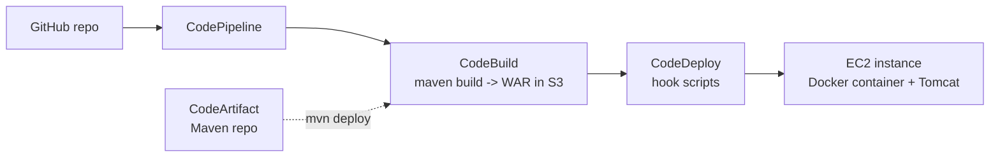
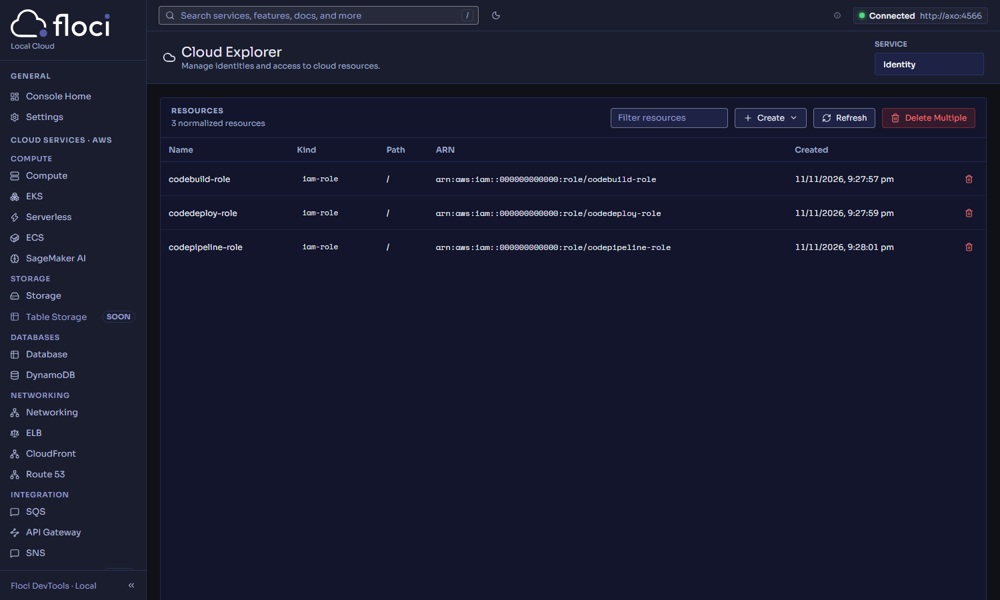
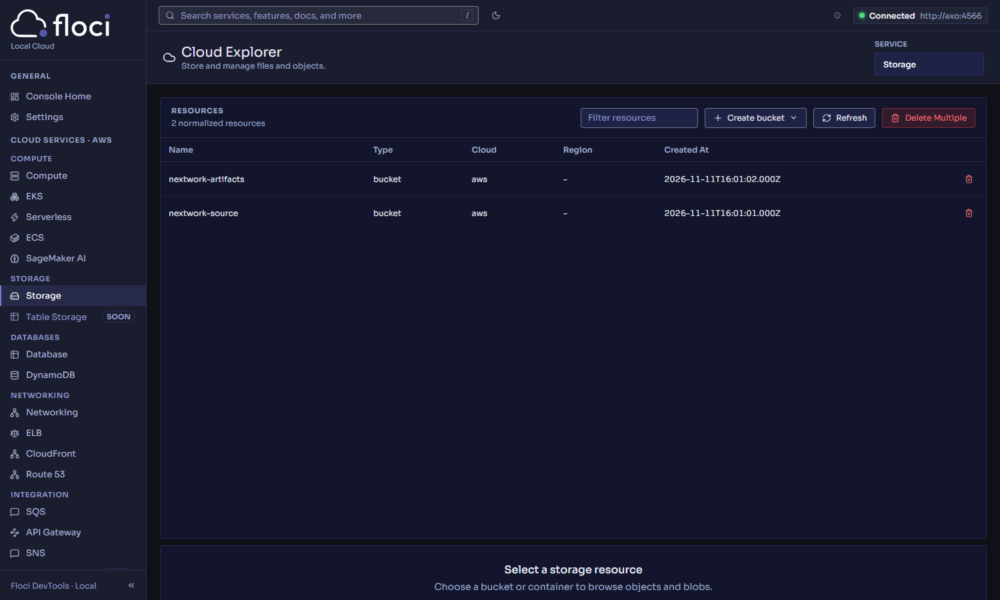

# CI/CD Pipeline on AWS services, run locally with Floci

A hands-on CI/CD pipeline for a Java web app that runs **entirely on your PC**: no AWS account, no cost.
It uses [Floci](https://github.com/floci-io/floci), a free local AWS emulator, plus PowerShell scripts that
create each stage with the real AWS CLI.



| Stage | AWS service (emulated) | What the script does |
|---|---|---|
| Source | GitHub | A public repo holding the Maven webapp |
| Packages | CodeArtifact | Publishes the artifact over the Maven endpoint |
| Build | CodeBuild | Builds the WAR in a `maven:3.5.2-jdk-8` container, uploads it to S3 |
| Deploy | CodeDeploy + EC2 + SSM | Runs hook scripts that fetch the WAR and start Tomcat |
| Orchestrate | CodePipeline | Source -> Build -> Deploy |

## Prerequisites
- Windows 10/11 with PowerShell 5.1+
- [Docker Desktop](https://www.docker.com/products/docker-desktop/) running
- [AWS CLI v2](https://aws.amazon.com/cli/) (`winget install -e --id Amazon.AWSCLI`)
- Git, and a GitHub account (the app source is pushed to a public repo)

## Quick start
```powershell
git clone https://github.com/axololtos/cicd-pipeline-floci.git
cd cicd-pipeline-floci\scripts
Set-ExecutionPolicy -Scope Process Bypass
.\01-start-floci.ps1
```
Floci listens on `http://localhost:4566` and mounts the Docker socket. Any access key works (`test`/`test`).
If you already run Floci on port 4566, step 1 reuses it.

Run the scripts in order, one per stage:

| Script | Does |
|---|---|
| `01-start-floci.ps1` | Starts (or reuses) Floci and checks the CLI can reach it |
| `02-webapp.ps1 -Name "You" -RepoUrl <empty-github-repo-url>` | Generates the Maven webapp, test-builds it, pushes it to GitHub |
| `03-codeartifact.ps1` | IAM roles, CodeArtifact domain + repo, `mvn deploy` |
| `04-codebuild.ps1` | Zips the source to S3, runs CodeBuild, WAR lands in S3 |
| `05-deploy.ps1` | Launches the EC2 container, installs Tomcat, runs a CodeDeploy deployment |
| `06-pipeline.ps1 -GitHubUser <you>` | Creates and runs the CodePipeline pipeline |
| `07-cleanup.ps1` | Tears the instance containers and compose Floci down |
| `08-screenshots.ps1` | Prints one feature per screen so you can screenshot each one |

When `05` finishes it prints the host port, e.g. "app port 8,080 on host port 30,000". Open
`http://localhost:30000/` to see the page. Each new PowerShell window needs `. .\env.ps1` (the other scripts
load it themselves). Generated files (the app, SSH key, zips) go in `scripts/work/`, which is git-ignored.

## Screenshots
| | |
|---|---|
|  |  |
|  |  |

## Floci limitations and the workarounds in these scripts
Floci emulates these services well, but a few behaviours differ from real AWS. Verified while building this:

- **CodeDeploy only queues hook commands for an SSM agent** and never runs them itself, and it fails a hook
  unless the command is acknowledged within about 500 ms. `scripts/ssm-agent.ps1` is a small stand-in agent that
  polls every 100 ms, runs each command in the instance with `docker exec`, and reports back. `05-deploy.ps1`
  starts it before creating the deployment.
- **CodeDeploy's EC2 tag-filter lookup finds nothing.** The group is instead given no filters, and the instance is
  registered as an on-premises instance named by its EC2 id.
- **CodeDeploy skips the bundle download and install steps.** The hook scripts fetch the WAR from S3 themselves.
- **CodeBuild only fetches `S3` or no source**, so the app is zipped to S3 instead of pulled from GitHub.
- **CodeArtifact doesn't resolve upstream repositories**, so Maven Central is still used for plugins.
- **The CodePipeline Deploy stage reports success without running hooks** (it hands CodeDeploy an S3 revision with
  no `appspec`). Source and Build are real. The actual deployment is run by `05-deploy.ps1`.

To release a change: edit the app in `scripts/work/nextwork-web-project`, run `04-codebuild.ps1`, then `05-deploy.ps1`.

## Troubleshooting
- **`aws` is not recognized:** open a *new* PowerShell window after installing the CLI.
- **`-- More --` appears and the script stalls:** press `q`. The scripts set `AWS_PAGER` to avoid this.
- **Port 4566 already allocated:** another Floci is running. Step 1 detects and reuses it.
- **"already exists" errors on re-runs:** harmless, the resources are kept between runs.

## Credits
The pipeline design follows the free "6 Day DevOps Challenge" by NextWork. This repo is an independent local-emulation
version and is not affiliated with NextWork or AWS. Floci is MIT licensed.

## License
MIT. See [LICENSE](LICENSE).
