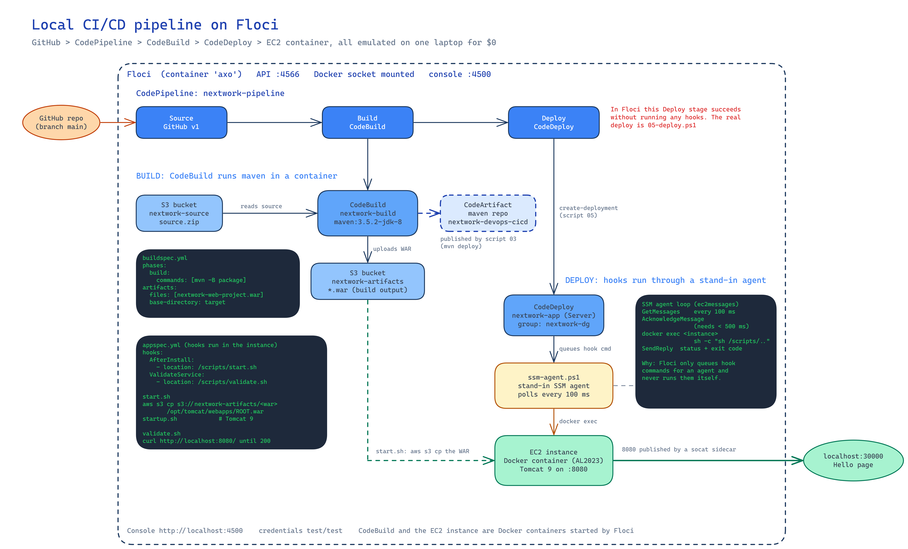
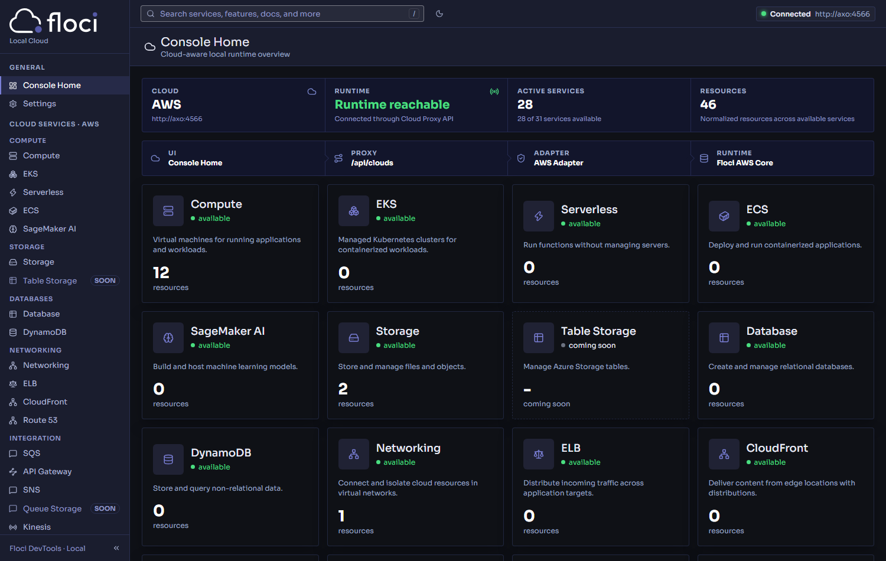
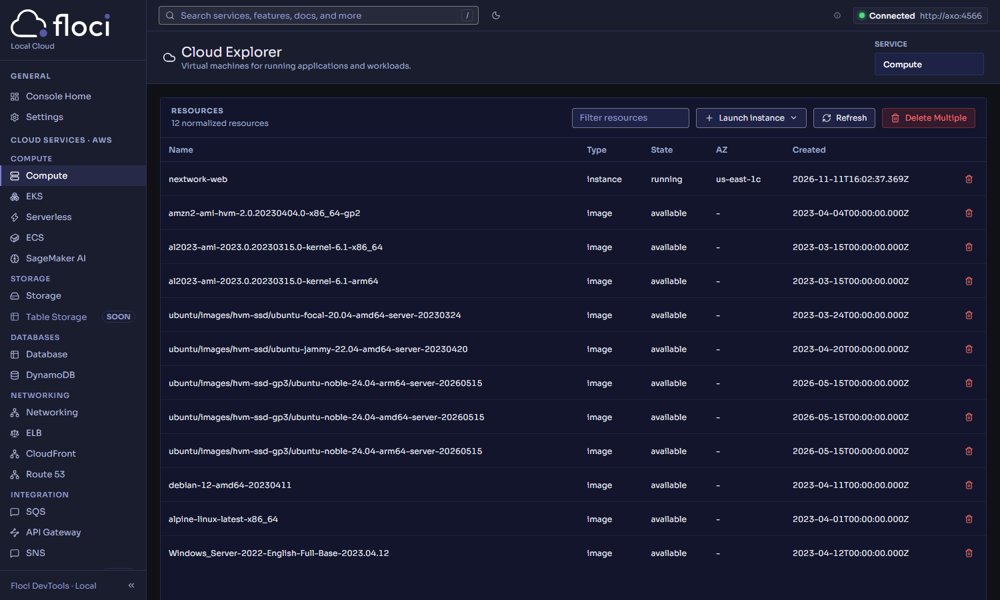

# CI/CD Pipeline on AWS services, run locally with Floci

Build, package and deploy a Java web app through **CodePipeline, CodeBuild, CodeArtifact and CodeDeploy** without an
AWS account and without paying anything. Everything runs on your own PC inside Docker, using
[Floci](https://github.com/floci-io/floci), a free local AWS emulator, and PowerShell scripts that create each stage
with the standard AWS CLI.

- Article: [Run AWS CodePipeline, CodeBuild and CodeDeploy locally with Floci](https://dev.to/axololtos_30/run-aws-codepipeline-codebuild-and-codedeploy-locally-with-floci-3k61)
- LinkedIn post: [Read the post](https://lnkd.in/p/gYfEzp39)



*Editable source: [`docs/architecture.excalidraw`](docs/architecture.excalidraw) (open it at [excalidraw.com](https://excalidraw.com)).*

## Contents
- [What you get](#what-you-get)
- [How it works](#how-it-works)
- [Prerequisites](#prerequisites)
- [Quick start](#quick-start)
- [Step by step](#step-by-step)
- [Resources it creates](#resources-it-creates)
- [Verify it works](#verify-it-works)
- [Releasing a change](#releasing-a-change)
- [Stopping, resuming and cleaning up](#stopping-resuming-and-cleaning-up)
- [Floci limitations and the workarounds](#floci-limitations-and-the-workarounds)
- [Troubleshooting](#troubleshooting)
- [Repository layout](#repository-layout)
- [Screenshots](#screenshots)
- [Credits and license](#credits-and-license)

## What you get
A working flow from source code to a running web page:

1. A Maven web app is generated and pushed to a public **GitHub** repo.
2. **CodeArtifact** stores the built package in a Maven repository.
3. **CodeBuild** compiles the app in a `maven:3.5.2-jdk-8` container and writes the WAR file to **S3**.
4. **CodeDeploy** runs hook scripts on an **EC2 instance** (a Docker container with Tomcat 9) that download the WAR and
   start the app.
5. **CodePipeline** chains Source, Build and Deploy stages.
6. You open `http://localhost:30000/` and see your page.

It is a learning and portfolio project. It is **not** a production setup (see [limitations](#floci-limitations-and-the-workarounds)).

## How it works
Everything lives in one Floci container (`axo` or `cmd-floci-1`) listening on `http://localhost:4566`. Floci starts
sibling Docker containers (the CodeBuild job and the EC2 instance) through the mounted Docker socket.

| Stage | Service | What the scripts do |
|---|---|---|
| Source | GitHub | Push the generated Maven webapp to a public repo (`main` branch) |
| Packages | CodeArtifact | Create domain `nextwork` and repo `nextwork-devops-cicd`, publish the artifact with `mvn deploy` |
| Build | CodeBuild + S3 | Zip the source to `nextwork-source`, run `buildspec.yml`, upload the WAR to `nextwork-artifacts` |
| Deploy | CodeDeploy + EC2 + SSM | Launch an Amazon Linux 2023 container, install Java and Tomcat, register it, run `AfterInstall` and `ValidateService` hooks |
| Orchestrate | CodePipeline | Pipeline `nextwork-pipeline`: GitHub source, CodeBuild, CodeDeploy |

Floci does not run CodeDeploy hooks on its own, so `scripts/ssm-agent.ps1` acts as the missing SSM agent. The diagram
above shows the loop.

## Prerequisites
| Need | Notes |
|---|---|
| Windows 10 or 11 | The scripts are PowerShell 5.1 (built in). They were developed and tested on Windows 11. |
| [Docker Desktop](https://www.docker.com/products/docker-desktop/) | Must be running (WSL 2 backend). Give it at least 4 GB RAM. |
| [AWS CLI v2](https://aws.amazon.com/cli/) | `winget install -e --id Amazon.AWSCLI`, then **open a new PowerShell window**. |
| Git | To push the sample app to GitHub. |
| A GitHub account | The pipeline's Source stage downloads from a **public** repo you own. |
| A GitHub personal access token | Classic token with the `repo` scope. Used once, when `02-webapp.ps1` pushes. |
| Free ports | `4566` (Floci API), `4500` (console), `30000` (the app). |
| Internet access | Docker images, Maven Central and the Tomcat download need it. First run takes about 5 to 10 minutes. |

You do **not** need an AWS account, real AWS credentials, or a LocalStack token.

## Quick start
```powershell
git clone https://github.com/axololtos/cicd-pipeline-floci.git
cd cicd-pipeline-floci\scripts
Set-ExecutionPolicy -Scope Process Bypass

.\01-start-floci.ps1
.\02-webapp.ps1 -Name "Your Name" -RepoUrl https://github.com/<you>/nextwork-web-project.git
.\03-codeartifact.ps1
.\04-codebuild.ps1
.\05-deploy.ps1
.\06-pipeline.ps1 -GitHubUser <you>
```
Before step 2, create an **empty public** repo named `nextwork-web-project` on GitHub (no README or `.gitignore`).
When `git push` asks for a password, paste your personal access token.

## Step by step
Run everything from the `scripts` folder, in order. Each script prints what it does and what success looks like.

| # | Script | What it does | You should see |
|---|---|---|---|
| 1 | `01-start-floci.ps1` | Starts Floci with `compose.yaml`, or reuses one already serving port 4566, then checks the CLI can reach it | Account `000000000000` |
| 2 | `02-webapp.ps1 -Name <text> -RepoUrl <url>` | Generates the Maven webapp in a container, writes `index.jsp`, `buildspec.yml` and `.gitignore`, test-builds, commits and pushes to `main`. Leave out `-RepoUrl` to skip the push | `BUILD SUCCESS` and a `.war` |
| 3 | `03-codeartifact.ps1` | Creates the IAM roles, the CodeArtifact domain and repo, and runs `mvn deploy` into it | `BUILD SUCCESS` and `Uploaded to codeartifact` lines |
| 4 | `04-codebuild.ps1` | Creates the buckets, zips the source, creates the CodeBuild project, runs a build, lists the output | `SUCCEEDED True` and the WAR in S3 |
| 5 | `05-deploy.ps1` | Launches the EC2 container, installs Java 8, Tomcat 9 and the AWS CLI, registers it with SSM, creates the CodeDeploy app and group, starts the stand-in agent and runs a deployment | `Deployment status: Succeeded` |
| 6 | `06-pipeline.ps1 -GitHubUser <you>` | Creates and runs the pipeline | Source, Build and Deploy all `Succeeded` |
| 7 | `07-cleanup.ps1` | Terminates instances and stops the compose-started Floci | n/a |
| 8 | `08-screenshots.ps1` | Shows one feature per screen so you can take screenshots | n/a |

Notes:
- **Re-running is safe.** "already exists" errors are harmless. `05-deploy.ps1` reuses the instance and redeploys.
- **Each new PowerShell window** needs `. .\env.ps1` to set the AWS variables (the numbered scripts load it themselves).
- **The app port** is printed at the end of step 5, for example "app port 8,080 on host port 30,000". Use that number.
- **First run** of step 5 installs about 120 packages inside the instance. Several minutes is normal.

## Resources it creates
| Kind | Name |
|---|---|
| IAM roles | `codebuild-role`, `codedeploy-role`, `codepipeline-role` |
| CodeArtifact | domain `nextwork`, repository `nextwork-devops-cicd` (Maven) |
| S3 buckets | `nextwork-source` (source.zip), `nextwork-artifacts` (the WAR) |
| CodeBuild | project `nextwork-build` |
| EC2 | instance tagged `Name=nextwork-web`, key pair `nextwork-keypair`, security group `web-sg` (port 8080) |
| CodeDeploy | application `nextwork-app` (Server), deployment group `nextwork-dg` |
| CodePipeline | pipeline `nextwork-pipeline` |
| Local files | `scripts/work/` (generated app, zips, SSH key; git-ignored) |

Credentials are always `test` / `test`, region `us-east-1`, account `000000000000`. Floci does not enforce IAM by default.

## Verify it works
```powershell
. .\env.ps1
aws sts get-caller-identity --output table
aws codepipeline get-pipeline-state --name nextwork-pipeline --query "stageStates[].[stageName,latestExecution.status]" --output table
```
Then open `http://localhost:30000/` (or your printed port). You can also browse everything in the Floci console at
`http://localhost:4500/console/aws` (IAM, S3, EC2).

## Releasing a change
1. Edit the page in `scripts\work\nextwork-web-project\src\main\webapp\index.jsp`.
2. `.\04-codebuild.ps1`: re-zips the source and rebuilds the WAR.
3. `.\05-deploy.ps1`: redeploys it to the instance.
4. Refresh the browser.

Commit and push from `scripts\work\nextwork-web-project` if you want the change on GitHub too.

## Stopping, resuming and cleaning up
**Stop everything** (leaves unrelated containers alone):
```powershell
docker stop @(docker ps -q --filter "name=floci-aws") axo
```
Use your Floci container's name instead of `axo` (`cmd-floci-1` if `01` started it from `compose.yaml`).

**Resume:** `docker start axo` (or `.\01-start-floci.ps1`), then re-run `03`, `04`, `05` if anything is missing.
With the bundled `compose.yaml`, Floci keeps state in memory, so a restart wipes it. To keep state across restarts,
add `FLOCI_STORAGE_MODE=hybrid` to the container's environment and mount a volume at `/app/data` (see the
[Floci storage docs](https://floci.io/floci/configuration/storage/); not tested in this repo).

**Clean up:** `.\07-cleanup.ps1`, then delete `scripts\work\` for a completely fresh start.

## Floci limitations and the workarounds
Floci covers these services well, but a few behaviours differ from real AWS. These were found while building this, and
the scripts work around each one:

| Limitation | Workaround in this repo |
|---|---|
| CodeDeploy only **queues** hook commands for an SSM agent and never runs them. It also fails a hook that is not acknowledged within about 500 ms | `ssm-agent.ps1` polls every 100 ms, runs each command in the instance with `docker exec`, and reports back. `05-deploy.ps1` starts it before creating the deployment |
| CodeDeploy's EC2 **tag-filter lookup** finds no instances | The instance is registered as an on-premises instance (named by its EC2 id) and the group has no filters |
| CodeDeploy **skips the bundle download and install** steps | The hook scripts fetch the WAR from S3 themselves |
| CodeBuild only supports **S3** or no source | The app is zipped to S3 instead of cloned from GitHub |
| CodeArtifact does not resolve **upstream** repositories | Maven Central is still used for plugins; only your own artifact goes to CodeArtifact |
| The CodePipeline **Deploy stage** reports success without running hooks (it sends an S3 revision with no `appspec`) | Source and Build are real. The actual deployment is `05-deploy.ps1` |
| The pipeline's CodeBuild project still reads `source.zip`, not the GitHub artifact | Re-run `04-codebuild.ps1` after editing code |
| Stale queued hook commands from a failed run can delay the next one past the 500 ms window | `05-deploy.ps1` drains the queue before starting |

## Troubleshooting
| Symptom | Fix |
|---|---|
| `aws` is not recognized | Open a **new** PowerShell window after installing the CLI |
| `NoCredentials` from the CLI | Run `. .\env.ps1` in that window |
| Output stalls at `-- More --` | Press `q`. The scripts set `AWS_PAGER` to prevent this, but older windows keep the old setting |
| `port is already allocated` on 4566 | Another Floci is running. Step 1 detects and reuses it |
| `docker ... cannot connect` | Start Docker Desktop and wait until it says running |
| Maven container "no POM" error in step 2 | Delete `scripts\work\nextwork-web-project` and re-run step 2 |
| `git push` rejected (fetch first) | The GitHub repo is not empty. Use `git push -u origin main --force` from `scripts\work\nextwork-web-project` only if you are happy to overwrite it |
| `Unauthorized` from `mvn deploy` | The CodeArtifact token was empty. Check `aws` works, then re-run `03` |
| Step 5: deployment `Failed` at `AfterInstall` | Read the "Why it failed" block it prints. Re-run `05`, since it is repeatable |
| `NoInstancesReachable` | Re-run `05`. It registers the instance as on-premises before creating the deployment |
| Page does not load on `:30000` | Use the port printed at the end of step 5. Check `docker ps` shows the `floci-aws-ec2-...` container |
| Everything is gone after a restart | Floci is in memory mode. Re-run `03`, `04`, `05` |

## Repository layout
```
.
├── README.md
├── LICENSE
├── .gitignore / .gitattributes   # work/ is ignored; .sh and .yml keep LF endings
├── docs/
│   ├── architecture.excalidraw   # editable diagram
│   ├── architecture.png          # exported diagram
│   ├── cover.png / cover.html    # blog cover image
│   └── screenshots/              # Floci console captures
└── scripts/
    ├── env.ps1                   # AWS variables + helper functions (sourced by every script)
    ├── compose.yaml              # Floci with the Docker socket mounted
    ├── 01-start-floci.ps1 ... 08-screenshots.ps1
    ├── ssm-agent.ps1             # stand-in SSM agent (started by 05)
    ├── appspec.yml               # CodeDeploy hooks
    ├── hooks/
    │   ├── start.sh              # fetches the WAR from S3, starts Tomcat
    │   └── validate.sh           # waits for http://localhost:8080/
    └── work/                     # generated at run time (git-ignored)
```

## Screenshots
| | |
|---|---|
|  |  |
|  |  |

## Credits and license
The pipeline design follows the free "6 Day DevOps Challenge" by NextWork. This repo is an independent local-emulation
version and is not affiliated with NextWork or AWS. [Floci](https://github.com/floci-io/floci) is MIT licensed.
All scripts here are MIT licensed. See [LICENSE](LICENSE).
